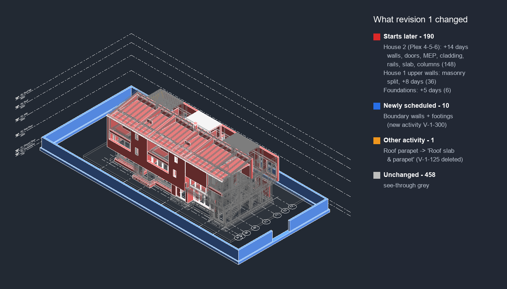

# P6 → Revit 4D (Claude Code skill)

Link a construction schedule to a building model and write it into Revit as 4D. Claude decides which model
elements each activity builds and writes down why. It asks the planner whenever the data can't decide, checks
the build order, and writes to Revit only after approval. When next month's schedule arrives, it keeps every
link that is still valid, re-maps only what changed, and shows in colour what moved.



## Why

4D tools (Navisworks TimeLiner, Synchro, Dynamo scripts) only link automatically when the schedule and the
model share the same code. On real projects they don't, so someone links activities to elements by hand
and redoes it on every revision.

In 34 real building XERs (126,838 activities):
- only 31% of activity names say where the work is;
- the same name repeats ("Pour" ×6), with the location shown only by the date order;
- formwork, rebar and pour all build the same slab.

That decision is the part this skill does.

## What it does

| Step | What happens |
|---|---|
| 1. Start | Reads a P6 XER (`--xer`) or an MS Project XML (`--msp`) |
| 2. Read the model | Live from Revit through MCP (`execute_revit_code`), or from an IFC file (`ifc_read.py`) |
| 3. Understand | Writes `brief.md`: where location lives in the schedule, the build sequence, and how the model is organised |
| 4. Map | Claude writes `map_rules.py`. Every activity is either linked with a reason or marked "no elements" with a reason. Repeated rounds are settled with evidence or asked |
| 5. Check | Unknown or undecided items, milestones with elements, build order, and repeated rounds left unresolved |
| 6. Planner gate | Questions with options and defaults. `answer.py` applies the answers and re-runs the rules. `approval.json` is required |
| 7. Write | Writes `P6_Task_ID`, `P6_Activity`, `P6_Start`, `P6_Finish`, `P6_All_Activities`, `P6_Week` and `P6_Month` on every element, and reports new / changed / moved / cleared |
| 8. Views | "by month", "as of <date>" or weekly 3D views, plus an activity-summary schedule and an every-element schedule |
| Revision | `revise.py` keeps unchanged links and maps only what changed. The changes view shows delayed (red), earlier (green), new (blue) and unchanged (see-through grey) |

The full workflow for Claude is in [SKILL.md](SKILL.md).

## Results (details in [docs/RESULTS.md](docs/RESULTS.md))

**A real project (IFC + MS Project), blind against the real project team's own 4D links.**
The project is Schependomlaan, an apartment building in NL (public dataset, CC BY 4.0) with 121 activities and
3,505 elements.

- 3,504 of 3,505 elements placed, with 16 planner questions.
- **Structure: 80%** the same building activity as the team.
- **82%** of elements appear within 2 weeks of the team's date.
- 12 links fail the build-order check, against 64 in the team's own links.
- Façade, roof and finishes: about 40–50% the same. A planner still reviews these. Part of the gap is the team's own links being inconsistent.

**A real P6 schedule with a sample Revit model, live in Revit.**
- Two independent mappings agreed on 98.7% of elements.
- 649 elements written with 0 failures.
- On a month-2 revision, Revit's write report matched the prediction exactly: 10 new, 37 changed activity, 154 dates moved and 458 unchanged.

## Install

### 1. The skill
1. Copy this folder to `~/.claude/skills/p6-revit-4d` (or your project's `.claude/skills/`).
2. Install Python 3.10+. `pip install ifcopenshell` is needed only to read IFC models.

With an IFC model, steps 1–6 (read, map, questions, check) work **without Revit**. Writing into Revit and
building the views needs a Revit MCP server.

### 2. A Revit MCP server (for live Revit)
The skill uses only 3 MCP tools: `execute_revit_code`, `set_active_view` and `get_revit_view`. The free,
open-source [revit-mcp-server](https://github.com/Demolinator/revit-mcp-server) (MIT, Revit 2024–2027) has all
three. The skill was built on a fork of it.

1. **pyRevit:** download the installer from [pyRevit releases](https://github.com/pyrevitlabs/pyRevit/releases),
   run it, and open Revit. A **pyRevit** tab appears.
2. **Routes server:** go to pyRevit tab → Settings → Routes, switch the server on (port 48884), save, and let pyRevit reload.
3. **Install `uv`** ([guide](https://docs.astral.sh/uv/getting-started/installation/)), then:
   ```
   git clone https://github.com/Demolinator/revit-mcp-server
   cd revit-mcp-server
   uv sync
   ```
4. **Load the server as a pyRevit extension:** create a folder such as `C:\pyRevitExtensions` and link the repo into it:
   ```
   New-Item -ItemType Junction -Path C:\pyRevitExtensions\revit-mcp.extension -Target C:\path\to\revit-mcp-server
   ```
   Then go to pyRevit → Settings → Custom Extension Directories, add `C:\pyRevitExtensions`, and reload.
   Don't use the "MCP Server for Revit Python" entry in pyRevit's extension manager; that is the older
   upstream version.
5. **Connect Claude:** add the server to Claude Code (`claude mcp add revit -- uv --directory C:\path\to\revit-mcp-server run main.py`)
   or to Claude Desktop's config. The server's own README has the exact JSON.
6. **Test:** open a project in Revit and go to http://localhost:48884/revit_mcp/status/ in a browser. It should
   report `active`. In Claude, ask "check Revit status".

Then ask Claude: *"link this P6 schedule to the open Revit model"* (attach the .xer), or *"here's next
month's XER, update the 4D"*.

Revit writes run inside one undoable transaction per step (Ctrl+Z in Revit). The skill never saves your file
unless you ask it to.

Then ask Claude: *"link this P6 schedule to the open Revit model"* (attach the .xer), or *"here's next
month's XER, update the 4D"*.

## Limits

- No public project publishes its P6 file together with its Revit model. Testing covered a real project as IFC + MS Project, and a real P6 schedule against a sample Revit model.
- Largest model tested: 3,505 elements.
- Links use Activity IDs, so renumbered activities show up as deleted and added.
- Revit doesn't allow parameters on stair balusters. They follow their railing and are hidden in 4D views.
- The skill links elements and writes dates. It doesn't create or change schedule logic.

## License

AutoConst Source Available License: free to use, including commercially within your own organisation. You may
not resell or rebrand it. See [LICENSE](LICENSE).

Built by Hamza Jabbar, [hamzajabbar.online](https://hamzajabbar.online)
